# Atelier
### Creative & Studio Suite

| | App | What it does |
|:-:|---|---|
|  | [**AetherCanvas AI**](https://github.com/CursedPrograms/AetherCanvas-AI) | Pictures and video from words, on your own PC. Text to image, image to image, inpainting, upscaling and video in one window, with ComfyUI and Python doing the work underneath. |
| 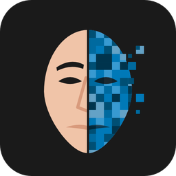 | [**Changeling Studio**](https://github.com/CursedPrograms/Changeling-Studio) | Every Changeling in one window: face swap on photos, videos and the webcam, makeup, hair and beards, age and more, each effect a set of sliders. |
| 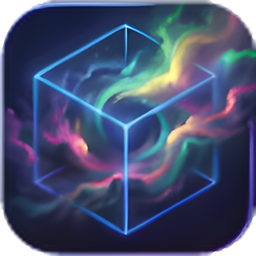 | [**Firmament**](https://github.com/CursedPrograms/Firmament) | 360° skyboxes from a prompt. Look round them, repair the seam, upscale them and export cube maps for games and 3D scenes. |
| 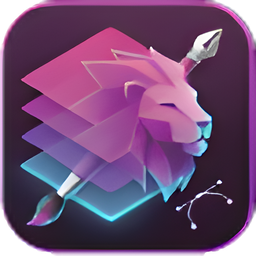 | [**Chimera**](https://github.com/CursedPrograms/Chimera) | A layer-based image editor: layers, masks, blend modes, filters, vector paths and the healing tools (Spot Healing, Remove, Patch, Content-Aware Fill and Move). Bathos and Mimic plug into its Filter menu; Inoculant protects what it saves and cures what it opens. |
| 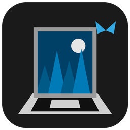 | [**Diorama**](https://github.com/CursedPrograms/Diorama) | An augmented-reality engine made like Unity: scenes on markers, tables, floors and walls, scripted in JavaScript and built into games for a phone's browser or a Windows player. |
| 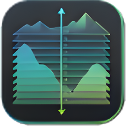 | [**Bathos**](https://github.com/CursedPrograms/Bathos) | A picture in, its depth map out: near is bright, far is dark. For 3D photos, parallax, fog and focus effects. |
| 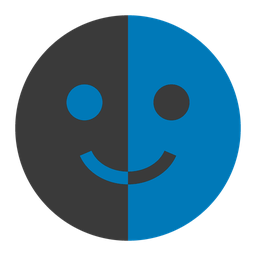 | [**Mimic**](https://github.com/CursedPrograms/Mimic) | One person's face onto a picture or a video, matched to the light and the expression. |
| 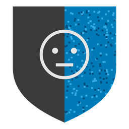 | [**Inoculant**](https://github.com/CursedPrograms/Inoculant) | Poisons and antidotes for your own pictures: cloaks the faces in them against face recognition and face swaps, and tests how much of a cloak survives. |
| 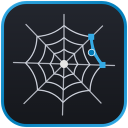 | [**Arachne**](https://github.com/CursedPrograms/Arachne) | Pictures into clean vector art (SVG): traced into smooth curves and flat shapes, or painted from words first and then traced. |
| 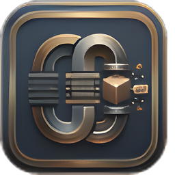 | [**CRUSH**](https://github.com/CursedPrograms/CRUSH) | A file compressor written from scratch, for the command line and Explorer's right-click menu. |
| 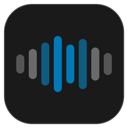 | [**Hymnal**](https://github.com/CursedPrograms/Hymnal) | Whole songs, with vocals, from a style: lyrics written for you, covers, remixes, stems, tempo and key. |
| 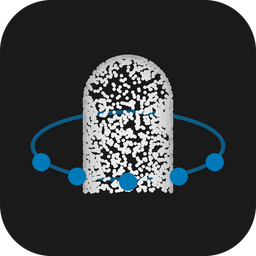 | [**Simulacrum**](https://github.com/CursedPrograms/Simulacrum) | Photos to a textured 3D model: photogrammetry in three steps, out as GLB, OBJ or STL. |
| 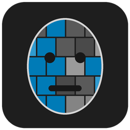 | [**Mosaic Mask**](https://github.com/CursedPrograms/Mosaic-Mask) | A disguise for video calls: your face as a shifting mosaic of AI-generated strangers, sent to Zoom, Teams, Discord or Meet as an ordinary camera. |
| 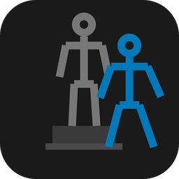 | [**Pygmalion**](https://github.com/CursedPrograms/Pygmalion) | People in 3D with sliders: MakeHuman remade. Shape them with sliders or by dragging the body itself, dress, pose, render, and export with the skeleton. |
|  | [**Demiurge**](https://github.com/CursedPrograms/Demiurge) | Make worlds: a 2D and 3D game engine with C#, built on Godot Engine 4.7. |

Coming: **Galatea**, a picture or a few words into a textured 3D model (GLB, OBJ).

## The Atelier launcher

One window to install the suite's apps, keep them up to date and start them. Installed together, they find each
other as plugins: Chimera's **Filter > Bathos** and **Filter > Mimic** use the Bathos and Mimic installed beside it.

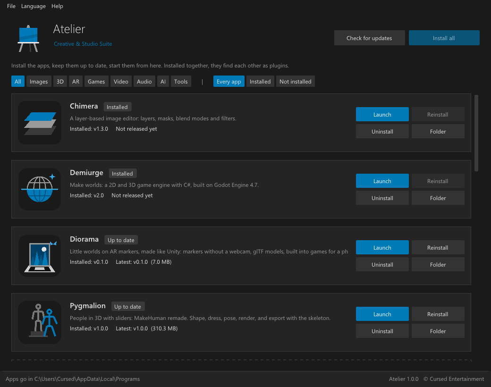

- **The apps:** Chimera, Bathos, Mimic, CRUSH, Hymnal, Simulacrum and Firmament, each with its logo, its line, the version installed and the latest
  release on GitHub, and **Install**, **Update**, **Launch**, **Uninstall** and **Folder** buttons. **Install all**
  installs or updates everything that's out of date. Downloads show their progress.
- **Where they go:** `%LOCALAPPDATA%\Programs\<App>`, the same folder each app's own installer uses (and where Chimera
  looks for `bathos-cli.exe` and `mimic-cli.exe`), with Start menu and Desktop shortcuts. Apps already installed
  are found and shown with their version. An app that's open isn't updated or uninstalled until it's closed.
- **CRUSH** is installed with its own installer (per user: crush on the PATH, Explorer's right-click entries);
  an existing install for everyone is updated for everyone. It has no window, so **Console** opens a console with it.
- **The catalog** is built in, and [`atelier.json`](atelier.json) in this repo is read on every start, so new apps
  can be added without a new launcher.
- **Offline or not:** the last answers from GitHub are cached; a release zip can also be installed by hand
  (File > Install from a zip, or drop it on the window).
- **Languages:** English, plus Japanese, Chinese, Spanish, Korean, French, German, Russian, Serbian, Afrikaans,
  Yucatec Maya and Pennsylvania Dutch (Language menu; packs are `lang/<code>.txt`, "English = translation").

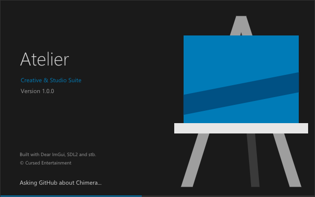

### Minimum requirements

| | |
| --- | --- |
| **System** | Windows 10 or 11, 64-bit |
| **Processor** | any 64-bit processor |
| **Memory** | 4 GB RAM |
| **Graphics** | any graphics card with OpenGL 3.0 |
| **Disk** | 5 MB for the launcher, plus each app you install (see its own page) |
| **Internet** | to download the apps |

### Install

Download **Atelier-Launcher-win64.zip** from [Releases](https://github.com/CursedPrograms/Atelier/releases), unzip
it and run `install.bat` beside it (or just run `Atelier.exe` where it is). It goes in
`%LOCALAPPDATA%\Programs\Atelier`, with Start menu and Desktop shortcuts. What it installed is remembered in
`installed.json` there, next to its cache and `launcher.log`.

### Build

Windows, with Visual Studio 2022 (C++) and CMake: `launcher\build.bat` (or `build.ps1`, or `build.sh` from Git Bash).
SDL2 is fetched into `launcher\external\` once, Dear ImGui 1.90.4 and stb by CMake. The result is
`launcher\build\Release\Atelier.exe` and `launcher\dist\Atelier-Launcher-win64.zip`; `install.bat` (`.ps1`, `.sh`)
installs it. `Atelier --capture shot.bmp [--lang de]` saves a screenshot of the window from a hidden window.

The code, in `launcher/src/`:
- `gui.cpp`: the window and the splash window (SDL2, OpenGL 3, Dear ImGui)
- `suite.cpp`: the catalog, GitHub's releases, what's installed, and the install / update / uninstall jobs
- `http.cpp`: downloads through WinHTTP; `json.cpp`: a small JSON reader; `lang.cpp`: the language packs
- `splash.cpp`: the splash art, drawn with ImGui's draw list

Built with [SDL2](https://www.libsdl.org), [Dear ImGui](https://github.com/ocornut/imgui) and
[stb](https://github.com/nothings/stb). Archives are unpacked by Windows' own `tar.exe`.

 

© Cursed Entertainment 2026

 

