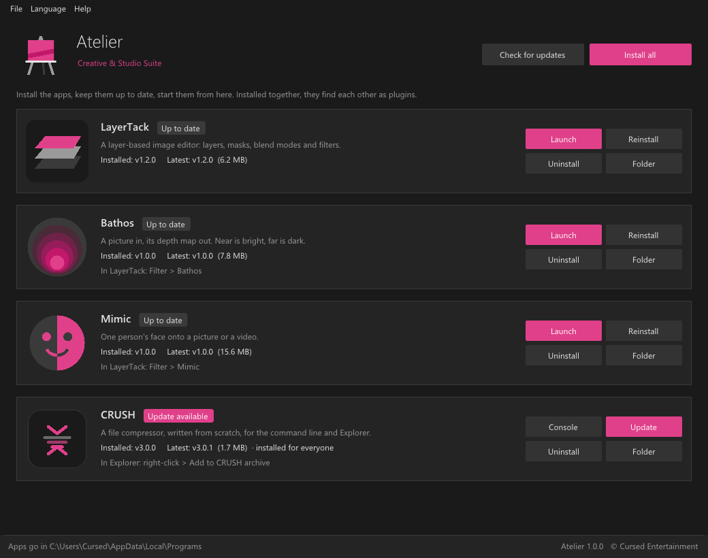
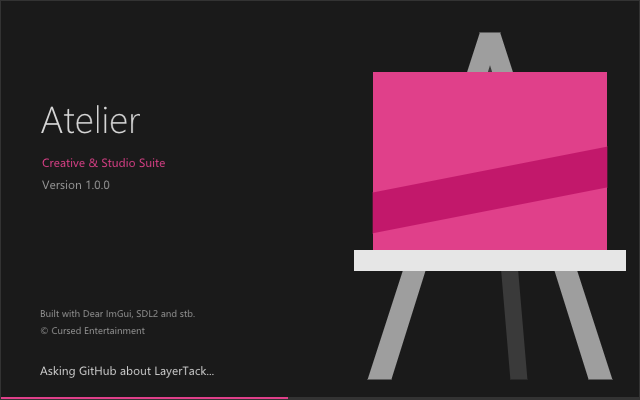

# Atelier
### Creative & Studio Suite

- https://github.com/CursedPrograms/AetherCanvas-AI
- https://github.com/CursedPrograms/Changeling-Studio
- https://github.com/CursedPrograms/Firmament
- https://github.com/CursedPrograms/LayerTack
- https://github.com/CursedPrograms/Bathos
- https://github.com/CursedPrograms/Mimic
- https://github.com/CursedPrograms/CRUSH
- https://github.com/CursedPrograms/Mosaic-Mask
- https://github.com/CursedPrograms/Spatiality
- https://github.com/CursedPrograms/Acacia-GameEngine

## The Atelier launcher

One window to install the suite's apps, keep them up to date and start them. Installed together, they find each
other as plugins: LayerTack's **Filter > Bathos** and **Filter > Mimic** use the Bathos and Mimic installed beside it.

- **The apps:** LayerTack, Bathos, Mimic and CRUSH, each with its logo, its line, the version installed and the latest
  release on GitHub, and **Install**, **Update**, **Launch**, **Uninstall** and **Folder** buttons. **Install all**
  installs or updates everything that's out of date. Downloads show their progress.
- **Where they go:** `%LOCALAPPDATA%\Programs\<App>`, the same folder each app's own installer uses (and where LayerTack
  looks for `bathos-cli.exe` and `mimic-cli.exe`), with Start menu and Desktop shortcuts. Apps already installed
  are found and shown with their version. An app that's open isn't updated or uninstalled until it's closed.
- **CRUSH** is installed with its own installer (per user: crush on the PATH, Explorer's right-click entries);
  an existing install for everyone is updated for everyone. It has no window, so **Console** opens a console with it.
- **The catalog** is built in, and [`atelier.json`](atelier.json) in this repo is read on every start, so new apps
  can be added without a new launcher.
- **Offline or not:** the last answers from GitHub are cached; a release zip can also be installed by hand
  (File > Install from a zip, or drop it on the window).
- **Languages:** English, plus Japanese, Chinese, Spanish, Korean, French, German, Russian, Serbian, Afrikaans,
  Yucatec Maya and Pennsylvania Dutch (Language menu; packs are `lang/<code>.txt`, "English = translation").

### Install

Download **Atelier-Launcher-win64.zip** from [Releases](https://github.com/CursedPrograms/Atelier/releases), unzip
it and run `install.bat` beside it (or just run `Atelier.exe` where it is). It goes in
`%LOCALAPPDATA%\Programs\Atelier`, with Start menu and Desktop shortcuts. What it installed is remembered in
`installed.json` there, next to its cache and `launcher.log`.

### Build

Windows, with Visual Studio 2022 (C++) and CMake: `launcher\build.bat` (or `build.ps1`, or `build.sh` from Git Bash).
SDL2 is fetched into `launcher\external\` once, Dear ImGui 1.90.4 and stb by CMake. The result is
`launcher\build\Release\Atelier.exe` and `launcher\dist\Atelier-Launcher-win64.zip`; `install.bat` (`.ps1`, `.sh`)
installs it. `Atelier --capture shot.bmp [--lang de]` saves a screenshot of the window from a hidden window.

The code, in `launcher/src/`:
- `gui.cpp`: the window and the splash window (SDL2, OpenGL 3, Dear ImGui)
- `suite.cpp`: the catalog, GitHub's releases, what's installed, and the install / update / uninstall jobs
- `http.cpp`: downloads through WinHTTP; `json.cpp`: a small JSON reader; `lang.cpp`: the language packs
- `splash.cpp`: the splash art, drawn with ImGui's draw list

Built with [SDL2](https://www.libsdl.org), [Dear ImGui](https://github.com/ocornut/imgui) and
[stb](https://github.com/nothings/stb). Archives are unpacked by Windows' own `tar.exe`.

 

© Cursed Entertainment 2026

 

